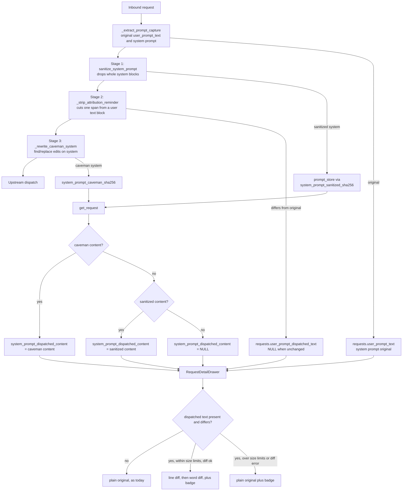

**Status**: Accepted

# Show proxy-stripped content as a diff in the request drawer

## Context

The request detail drawer shows what the client sent: `user_prompt_text` and the system prompt are captured in `_extract_prompt_capture` before the sanitizer, the attribution strip (ADR-0023) and the caveman rewrite (ADR-0022) run. An operator who sees a reminder in the drawer cannot tell whether the proxy removed it upstream. The only evidence is an INFO log line, and the "Stripped Blocks" list covers sanitizer blocks only.

Three stages change content before dispatch: the sanitizer drops whole system blocks, the attribution strip cuts one span out of a user text block, and the caveman rewrite applies `{find, replace}` edits whose `replace` may be non-empty.

The flow below shows where content is captured, where each stage changes it, what is stored, and how the drawer reads it back.

## Decision

Render removed text as strikethrough and inserted text as a highlight, by diffing the original against the dispatched text in the UI.

1. **Stages.** All three. Caveman edits show struck-through old text plus highlighted new text. Inline `role:'system'` messages are not shown in the drawer today and stay out of scope.
2. **Representation.** Store before and after; the UI computes the difference. No stage reports spans or offsets. A future stage must persist its output and take a place in the server-side precedence chain of Decision 4, but needs no span plumbing. Rejected: per-stage span annotations (offsets into a JSON-serialized system string are fragile and every stage must report them) and inline marker tags in stored text (they corrupt the as-sent record and the FTS index).
3. **User prompt.** Only the last user message is diffed, matching the existing "User prompt" panel. New nullable column `requests.user_prompt_dispatched_text` (schema v5 → v6), captured after the attribution strip and written only when it differs from `user_prompt_text`; NULL means sent unchanged. FTS keeps indexing the original.
4. **System prompt.** One diff, original to dispatched. `get_request` joins `system_prompt_caveman_sha256` and returns `system_prompt_dispatched_content`: the caveman content, else the sanitized content, else NULL. The server owns the stage order; the UI never encodes it.
5. **Drawer.** A changed panel renders the diff by default with a "changed by proxy" badge: removed text `line-through` in muted red, inserted text highlighted green. The copy button copies the original. An "as sent" toggle shows the plain dispatched text: the diff mixes removed and inserted text, and an operator checking what upstream received needs the clean result. Unchanged requests render as today. The "Stripped Blocks" section stays, since it also lists flagged-but-not-stripped blocks that no diff can show.
6. **Granularity.** Line diff on the pretty-printed text (the `prettyPrintMaybeJson` output the panel shows), then a word diff inside each changed line pair. The drawer first checks input size: above 2,000 lines or 200,000 characters in either text (the character cap covers a JSON block-list prompt that keeps each block on one line), it skips the diff and shows the plain original plus the badge, so a 100 KB system prompt cannot freeze it. The same fallback applies when the diff step throws.
7. **Library.** jsdiff (`diff` on npm, about 30 KB, no dependencies). `dist/` is rebuilt with `make ui-build` and committed. Rejected: a hand-written LCS diff, which is more code to own and test.

## Consequences

- The dispatched user text lives inline in the `requests` row, not in `prompt_store`, so it is not deduplicated; a changed last-user message costs one extra text column on that row only.
- The ref-count triggers already count `system_prompt_caveman_sha256`, so no trigger change is needed.
- The v5 → v6 migration is additive (`ALTER TABLE ... ADD COLUMN`), like the caveman column in v5.
- Requests recorded before this ships have NULL `user_prompt_dispatched_text` and render as unchanged. The system prompt needs no backfill: old rows with stored sanitized or caveman content already get a system diff, because `get_request` derives it from existing hashes.
- Recording must never affect request handling. A failure to capture the dispatched text logs a warning and leaves the column NULL; a diff error shows the plain original.
- Requests that never reach dispatch (local replies, pre-dispatch failures) have NULL dispatched columns, which means no data, not sent unchanged.
- A strip in an earlier user turn gets no badge, since only the last user message is diffed (Decision 3).
- The drawer's trust boundary is unchanged (ADR-0004).
