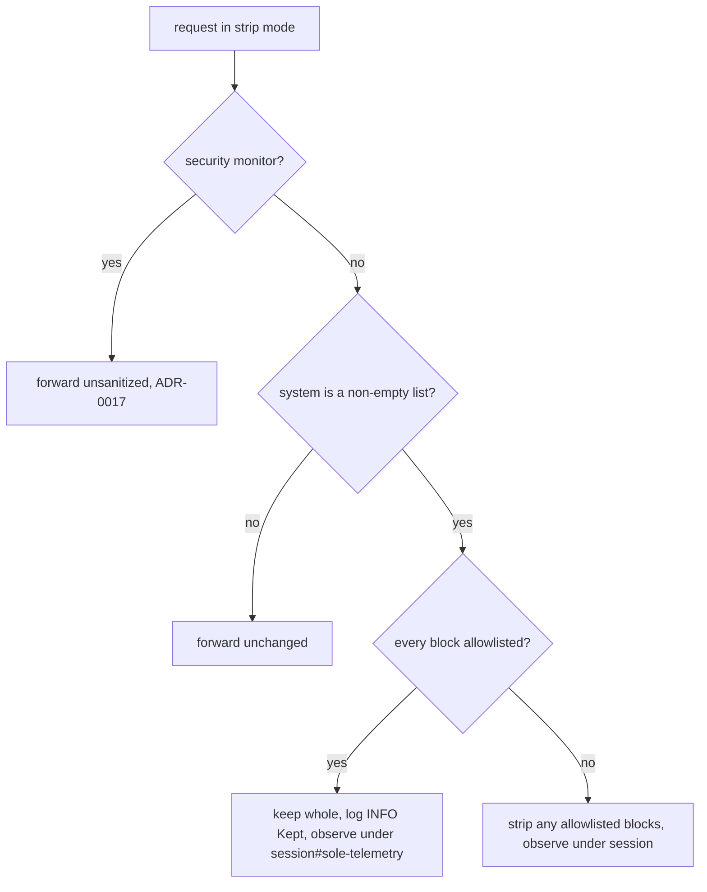

**Status**: Approved; Decisions 1-4 superseded by ADR-0029

# Keep the billing block when it is the only system block

## Context

In `strip` mode the sanitizer removes every system block that starts with `x-anthropic-billing-header:` (`VOLATILE_SYSTEM_BLOCK_PREFIXES` in `anthrouter/mapper/common.py`). The billing block carries a per-request `cc_prompt_id`, so it breaks the prompt-cache prefix on every turn. Until now `strip_volatile_system_blocks()` also removed it when it was the only block, and the request went upstream with `system: []`.

Claude Desktop sends subagent and task-notification turns whose `system` field holds only the billing block: no Claude Code identity block, no tools. On 2026-11-02, all 95 requests of this shape were stripped to `[]`, and upstream answered every one with a header-less `429 rate_limit_error: Error` (no `retry-after`, no `anthropic-ratelimit-*` headers, under 0.7 s). Identity-bearing requests on the same token and model succeeded in the same minutes. Security-monitor requests, which are also identity-less but keep their billing block (ADR-0017), succeeded too. Research: `docs/research/2026-11-02-rate-limit-billing-header-only.md`.

This is the mechanism ADR-0017's amendment found for the security monitor. That fix exempted only the monitor prefix.

## Decision

1. `strip_volatile_system_blocks()` returns `(system, False)`, the original object unchanged, when every block in a list-form `system` field matches the allowlist. When at least one non-matching block remains, it strips as before.
2. The rule is "never strip to empty". It does not depend on an identity block being present. A request with `[billing, "You are a helpful bot."]` still loses its billing block.
3. `sanitize_system_prompt()` logs one INFO line when it keeps the block for this reason: `Kept N volatile telemetry block(s): stripping would empty the system prompt (ADR-0025)`. The sanitized hash equals the original hash, `dropped` is 0, and `stripped_blocks` is empty, so the request drawer (ADR-0024) shows no diff. No DB column and no reason code are added.
4. The volatility tracker still observes the outbound prompt, under its own key `<session>#sole-telemetry`. A billing-only turn often shares a session with stripped turns whose index 0 is the constant identity block. On one key its varying billing block would make that identity block look volatile and raise a false `no allowlist match` warning. The tracker reports only blocks at or before the last `cache_control` breakpoint; a system array with no breakpoint reports nothing. So a kept block is flagged only when it sits at or before a breakpoint and varies across billing-only turns. The flag is a WARNING with the reason `Not stripped: every system block is allowlisted.`
5. Only list-form `system` is in scope. The sanitizer never strips a string-form `system`, so a string-form prompt already goes upstream unchanged.

The rejected alternative was to strip the billing block only when a Claude Code or Agent SDK identity block remains. It would also protect identity-less requests that have other system blocks. One such failure has been observed: the security monitor, before ADR-0017's amendment. That case is already handled by the monitor exemption. No failure has been observed for any other identity-less request with other system blocks. So the broader rule would today cover only one shape that the narrow rule misses, and that shape is already fixed. Its cost is a list of identity prefixes that must track every Claude Code and Agent SDK release. A missing prefix fails safe, keeping the billing block at the price of a cache miss, but the list is upkeep for a shape no unhandled failure has shown. By the inferred mechanism, Decision 2's `[billing, "You are a helpful bot."]` example is expected to get the 429 too; the narrow rule accepts that unverified risk because no such traffic has been seen. The narrow rule needs no list and covers every failure not already handled by ADR-0017.

## Consequences

- Billing-only requests go upstream unchanged. Each one misses the prompt cache. These requests are short and have no tools, so the cost is small.
- Identity-less requests that also carry another system block still lose their billing block, except security-monitor requests (ADR-0017). If upstream rejects another request of that shape, a new decision is needed. The broader identity-prefix rule above is the candidate.
- Not confirmed: that a billing-only request succeeds on every model. The security-monitor contrast points to request shape, not model. The check is the next billing-only request after deploy: it should record `success`, and the log should show the `Kept … volatile telemetry block(s)` line. If it still gets the header-less 429, this decision reopens, and the identity-prefix rule is the candidate.
- Narrows the sanitizer rule inherited from anthproxy's ADR-0029, which let an all-telemetry system field sanitize to nothing.
- Generalizes ADR-0017's amendment from the security-monitor prefix to every billing-only request. The monitor exemption stays: a monitor request carries other system blocks, so this rule alone would not keep its billing block.
