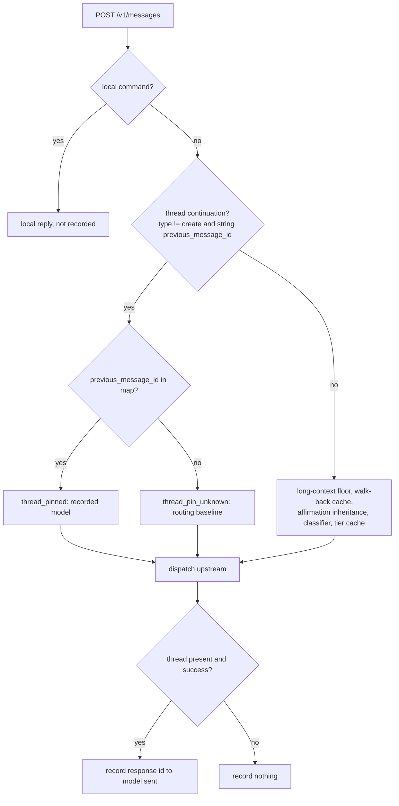
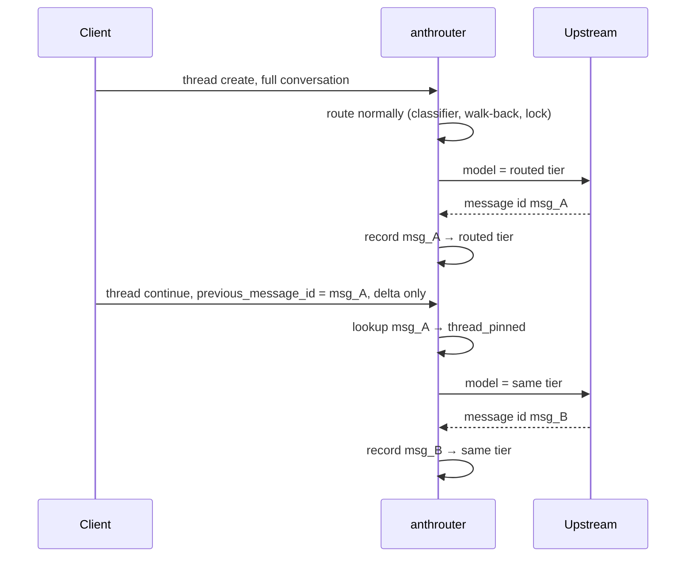

**Status**: Approved

# Pin a Thread continuation to the model that served its previous message

## Context

On 2026-11-02 Anthropic released **message threads** in beta (header `message-threads-2026-08-12`, [API release notes](https://platform.claude.com/docs/en/release-notes/api)). Upstream keeps the conversation, and later requests send only the new messages. The first request carries `thread: {"type": "create"}` and the full conversation. Each later request carries `thread: {"type": "continue", "previous_message_id": "msg_…"}` and only the delta. The release notes say a Thread expires 5 minutes after its last request and is deleted no more than 1 hour after its last use. Secondary sources ([Unite.AI](https://www.unite.ai/anthropic-launches-message-threads-beta-for-long-running-agents/), [vercel/ai#24409](https://github.com/vercel/ai/issues/24409), [pydantic-ai#12257](https://github.com/pydantic/pydantic-ai/issues/12257)) add the following: changing `model` or a create-only field such as `system` or `tools` needs a new Thread, each response id can be continued once, and the client should replay the full conversation as a new Thread when the Thread is gone. The official notes read so far do not confirm these points. The 400 below confirms the `model` rule.

### Upstream API change: message threads (beta)

| Item | Value | Source |
| ---- | ----- | ------ |
| Released | 2026-11-02, beta | release notes |
| Beta header | `anthropic-beta: message-threads-2026-08-12` | release notes |
| Create a Thread | `"thread": {"type": "create"}` plus the full conversation | secondary |
| Continue a Thread | `"thread": {"type": "continue", "previous_message_id": "msg_…"}` plus only the new messages | secondary; `previous_message_id` confirmed by the upstream errors below |
| Fixed per Thread | `model` (confirmed by the 400 below). `system` and `tools` are create-only (secondary). | upstream error, secondary |
| Lifetime | Expires 5 min after its last request. Deleted no more than 1 h after its last use. | release notes |
| Continue once | Each response id can be continued only once | secondary, unverified |
| Mismatch error | `400 invalid_request_error`, `thread: … differing field(s): model` | anthrouter log |
| Expired error | `404`, `No thread state was found for the requested previous_message_id. Replay the full conversation with thread: {"type": "create"} …` | anthrouter log |
| Billing | Pricing and rate limits are unchanged; the whole conversation is still read every turn | secondary |

The release notes do not document the 404, and they do not list `thread_not_found` as an error type. The only related error in them is `previous_message_not_found`, which belongs to the separate cache-diagnostics beta (`diagnostics.previous_message_id`, 2026-05-13 and 2026-09-09). anthrouter forwards the beta header and the `thread` field unchanged (`build_body` copies every non-internal key).

Claude Desktop (`cc_version=2.1.309`) started sending Thread turns through anthrouter at 22:32Z the same day. anthrouter routes every turn on its own, so it changed `model` inside a Thread. Upstream rejected 216 continuations with:

```
HTTP 400: thread: the request does not match the stored Thread for the requested `previous_message_id`; differing field(s): model. These fields must stay the same across a Thread's turns; ...
```

The client then replayed the whole conversation with `{"type": "create"}`, and that replay succeeded on any model. So each affected turn cost two failed requests (one streaming, one not) plus a replay that throws away the Thread's latency gain.

Routing changes the model because a continuation carries only the delta. `total_messages` is 2. Three cases follow:

- A tool-result-only delta has no user text. `route_model()` returns `missing_final_user_text` and falls back to the routing baseline: `--lock-requested-model sonnet` in the affected install. The Thread had been created on `haiku` or `opus`.
- The tier cache cannot rescue it. The cache is keyed by `context_key()`, which is the session key plus a hash of the first user message (`handlers.py:313-317`). A continuation's first user message is the delta, not the conversation's opening turn, so its key never matches the key of the turn that created the Thread.
- A delta with short user text (for example `Resume 03 here`) is classified on its own and can land on any tier.

Investigations: sessions `9a0efeeb` (#18166–#18184) and `84fe251b` (#18208–#18234). In every case, a continuation sent to the model of the Thread's previous turn succeeded, and one sent to any other model failed.

## Decision

1. **Detection.** A request is a *Thread continuation* when `payload['thread']` is a dict, its `type` is not `"create"`, and it carries a string `previous_message_id`. Every other request, including `{"type": "create"}` and a `thread` with no string `previous_message_id`, is routed as before. A future type other than `continue` that names a `previous_message_id` is pinned on purpose: naming a previous message ties the request to that message's Thread, and that Thread's model is fixed.
2. **Recording.** When a request that carried a `thread` (create or continue) finishes successfully, `SessionState` records `upstream message id → model sent upstream`. The model is the resolved routed model, not the name echoed to the client. "Successfully" means: on the streaming path, the stream reached `message_stop` with no `error` event, and the id is taken from `message_start.message.id`. On the non-streaming path, upstream answered 200, and the id is the top-level `id` of the JSON response. A stream that errors or is cut off after `message_start` records nothing, so its next continuation gets `thread_pin_unknown` (Decision 5). Local replies (`_local_message`, `_local_sse`) are never recorded, because their `msg_…` ids were never seen upstream.
3. **Storage.** The map is a new bounded `OrderedDict` on `SessionState`, keyed by message id alone. Ids are globally unique, and a continuation's context key differs from its Thread's, so neither the session key nor the context key works as the key. Entries are evicted oldest-first at `MAX_ENTRIES`, which rises from 1000 to 10000. The bound is shared by every `SessionState` map. It is raised for all of them on purpose: one constant keeps the maps' eviction behaviour the same, and the other maps' entries are small (Consequences). There is no TTL. The map is lost on restart. An entry that outlives its Thread does no worse than the baseline would. Under the documented 5-minute expiry, upstream answers that continuation with a 404 whatever model it is sent to (ADR-0028). If the unverified rules (continue once, or a 404 with another cause) do not hold, a stale entry sends the Thread's previous model, which at worst gets the same 400 or 404 the baseline would.
4. **Precedence.** The pin is the first routing layer. It runs after local-command interception and before the long-context floor, the walk-back cache, affirmation inheritance and the classifier. A pinned turn makes no classifier call and neither reads nor writes the tier cache. The pin overrides:
   - a lock or baseline set after the Thread was created. A Thread created on `opus` stays on `opus` after the operator sets `--lock-requested-model sonnet`, because upstream rejects any model change inside a Thread with a 400. Moving to the new baseline needs a new Thread, which only the client can start.
   - a change of the client's requested model mid-Thread. A continuation that asks for `claude-opus-5-5` on a Thread created from a `claude-fable-5-1` request stays on the recorded model. The requested model is still echoed in the response. A client calling upstream directly would get the same 400 for that switch.


5. **Reason codes.** Two codes are added to the `ReasonCode` literal:
   - `thread_pinned`: the `previous_message_id` was found. `routed_model` is the recorded model.
   - `thread_pin_unknown`: the id was not found (restart, eviction, or a Thread created before this change). `routed_model` is the routing baseline: the lock model when `--lock-requested-model` is set, else the requested model (ADR-0016).

   In both cases `payload['model']` equals `routed_model`, `applied = (routed_model != requested)`, and the response echoes the client's requested model as before.

   **Long-context window.** The pin skips the size floor, and the floor is the only place that adds the `context-1m` beta. So each map entry also records whether the dispatched request carried a `context-1m*` beta, and a `thread_pinned` turn whose entry has it gets the beta added again. This keeps the Thread's 1M window; it is not a re-route. A check on the `[1m]` model suffix is not enough, because `--auto-model-routing-long` accepts a target without it.
6. **Logging.** The `Routing request:` line gains `thread=<type>` when the payload has a `thread`. The type is logged as `create` or `continue`, any other string as `other`, and a missing or non-string type as `none`, so the client-controlled field cannot forge or bloat log lines. The ids are not logged.



## Considered Options

- **Pass every Thread turn through on the requested model, with no map.** This is stateless and survives a restart. It was rejected because the creating turn is still routed. A Thread created on `haiku` for a `claude-fable-5-1` request would then get the same 400 on its first continuation. The other way to make this option work is to stop routing the creating turn too, which removes all savings for a Thread-using client.
- **Key the pin by session or context key.** Rejected. A session can hold several Threads (sub-agents), and a continuation's context key never matches its Thread's (Context).
- **Strip `thread` in `build_body`, the way `fallbacks` is stripped.** Rejected. A continuation carries only the delta, so without `thread` upstream would answer a two-message conversation with no history.

## Consequences

- A Thread runs on one model for its whole life. The tier chosen on the creating turn holds even when a later turn would have been classified differently. Within a Thread, savings come only from the creating turn's routing decision.
- After a restart, every live Thread's next continuation goes out on the baseline. If the Thread was created on a different model, upstream answers 400 and the client replays. That is the same cost as before this change, and it happens once per Thread.
- The fail-closed invariant holds for `thread_pin_unknown`, which dispatches the baseline as ADR-0016 requires. `thread_pinned` is a deliberate exception to ADR-0016's "never selects a tier the configured baseline would not already have served". When the lock or baseline changed after the Thread was created, a pinned turn can dispatch a pricier tier than the current baseline. The tier is still one the router chose for this Thread, and any other model would get a 400.
- Memory at 10000 entries per map: the Thread map holds `(id, model)` string pairs of about 100 bytes each, roughly 1 MB. The tier cache (`(ctx_key, tier) → tier`), the context observations (`ctx_key → (int, float)`) and the routing overrides (`session_key → bool`) hold keys of under about 200 bytes, roughly 2 MB each at most. The total stays under about 10 MB.
- **Open risk:** the sanitizer, the caveman rewrite and the attribution strip still run on continuation turns. Today they do not cause failures: billing-only continuations succeeded in `warn` mode, and ADR-0025 keeps a sole billing block. But if upstream treats `system` as a create-only field that must match, a rewrite that differs between the creating turn and a continuation would produce a new 400 naming `system`. If that 400 appears, a new decision is needed.
- **Closed question (evidence in ADR-0031):** the 404 `No thread state was found` comes from the documented 5-minute expiry. On 2026-11-02 and 2026-11-03, every Thread 404 followed an idle gap of more than 5 minutes, and the continuation was pinned to the Thread's own model. No `thread_pinned` continuation succeeded after a gap of more than 235 s. ADR-0031 sends this 404 to the client as a 400, so the client replays.

## Origin

Investigations of 2026-11-02 (sessions `9a0efeeb` and `84fe251b`, causes A and B). The 404 half of cause B is handled by ADR-0028.
