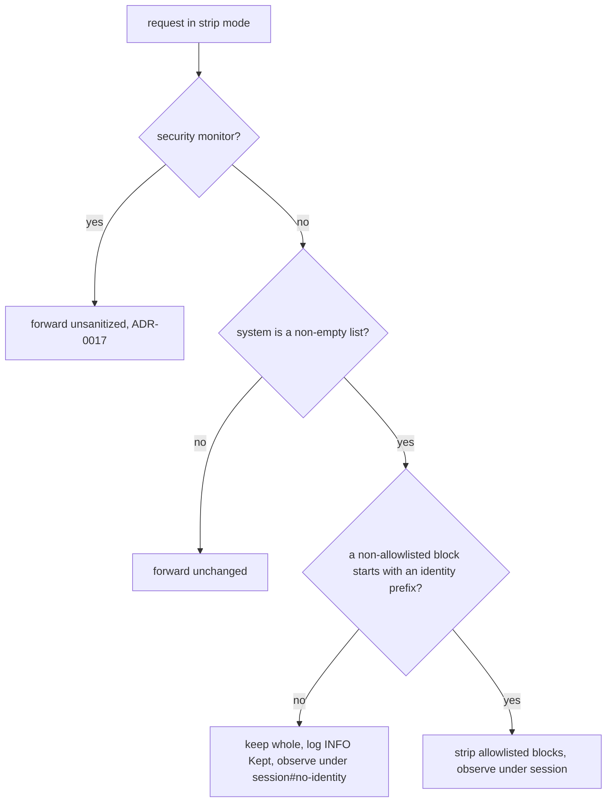

**Status**: Approved

# Strip the billing block only when an identity block remains

## Context

ADR-0025 made `strip_volatile_system_blocks()` (`anthrouter/mapper/common.py:173-192`) keep a list-form `system` field whole when every block is allowlisted. It rejected a broader rule: strip the `x-anthropic-billing-header:` block only when a Claude Code or Agent SDK identity block remains. Its Consequences said a new decision was needed if upstream rejected an identity-less request that carries another system block, and named the identity-prefix rule as the candidate.

That failure has now been observed. On 2026-11-02, requests 17144-17149 had `system = [billing block, "You transform a mechanically-gathered recon block into a JSON proposal..."]`. The sanitizer removed the billing block, which left one non-identity block. All 6 got the header-less `429 rate_limit_error: Error`. None succeeded.

This is the third identity-less shape to fail the same way:

| Shape | Marker left after strip | Result | Fix |
|---|---|---|---|
| Security monitor | none | 429 (ADR-0017 amendment) | prefix exemption, forwarded unsanitized |
| Billing block only | none, `system: []` | 429, 95 of 95 | ADR-0025, keep when all allowlisted |
| Billing + recon prompt | none | 429, 6 of 6 | this ADR |

In every recorded case, an identity-less request that kept its billing block succeeded, and one that lost it got the 429. Identity-bearing requests whose billing block was stripped succeeded (`docs/research/2026-11-02-rate-limit-billing-header-only.md`, lines 43 and 93). The inferred mechanism is ADR-0025's: upstream rejects a request that carries neither the identity block nor the billing block.

## Decision

1. `strip_volatile_system_blocks()` removes allowlisted blocks only when at least one remaining block is an identity block. Otherwise it returns `(system, False)` with the original object unchanged. This replaces ADR-0025 Decision 1 and Decision 2. ADR-0025's all-allowlisted case is covered, because an empty remainder has no identity block.
2. An identity block is a dict block whose `text`, after `lstrip()`, starts with a prefix in a new tuple `IDENTITY_SYSTEM_BLOCK_PREFIXES` in `anthrouter/mapper/common.py`, next to `VOLATILE_SYSTEM_BLOCK_PREFIXES`. The block can be at any index. The initial entries:
   - `You are Claude Code, Anthropic's official CLI for Claude`. This also matches the `..., running within the Claude Agent SDK.` form seen in the research note.
   - `You are a Claude agent, built on Anthropic's Claude Agent SDK`. This is the Agent SDK's default prompt. It has not been confirmed against recorded traffic.
   As with the volatile allowlist, entries are added by changing the code, not by configuration.
3. A missing prefix fails safe. A request whose identity block is not on the list keeps its billing block. It misses the prompt cache, but it is never rejected because of the sanitizer. So the list only has to be complete for caching to work; requests succeed without it.
4. `sanitize_system_prompt()` (`anthrouter/sanitizer.py:88-108`) logs one INFO line whenever it keeps allowlisted blocks for this reason: `Kept N volatile telemetry block(s): no identity block in the system prompt (ADR-0029)`. That line replaces ADR-0025's line. As in ADR-0025, the sanitized hash equals the original hash, `dropped` is 0, `stripped_blocks` is empty, and no DB column or reason code is added.
5. The volatility tracker observes a kept request under `<session>#no-identity`, which replaces ADR-0025's `#sole-telemetry` key. The reason is the same as before: a kept billing block at index 0 must not be compared with the stripped turns' constant identity block at index 0. A flagged kept billing block gets the reason `Not stripped: no identity block in the system prompt.` That replaces `every system block is allowlisted`.
6. ADR-0017's monitor passthrough stays. It also skips routing and the lock, which this rule does not do. Its sanitizer exemption is now redundant, but it is harmless.

### Rejected alternatives

- **Exempt by shape.** Add a prefix exemption for the recon prompt, as ADR-0017 did for the monitor. Every new identity-less shape would fail with a 429 until someone noticed it and added an exemption. That is how the last three shapes were found. The failure points to a missing marker, not to a particular prompt.
- **Move the billing block instead of deleting it.** For identity-less requests, put the billing block after the last `cache_control` breakpoint. That would keep both the marker and the cache. But nothing shows that upstream accepts the block anywhere except index 0. If it does not, the 429s come back. The idea could be tested later with one controlled request.

## Consequences

- Identity-less requests that carry other system blocks lose prompt caching. The billing block's `cc_prompt_id` sits at index 0 and changes on every request. For the recon shape, every turn is a cache write on the whole system prefix. The size of that cost has not been measured. A request that is rejected costs more.
- Requests with an identity block are unchanged. Their billing block is stripped as before.
- The cost is upkeep of the prefix list. A new Claude Code or Agent SDK identity wording that does not match a listed prefix costs a cache miss on every turn of that client, until the prefix is added. The INFO `Kept` line on identity-bearing traffic shows when this happens.
- Not confirmed: that keeping the billing block is enough for every identity-less shape. The check is the next recon-shape request after deploy. It should record `success`, and the log should show the `Kept … no identity block` line. If it still gets the header-less 429, the mechanism is wrong and this decision reopens.
- Narrows ADR-0025 Decision 2: `[billing, "You are a helpful bot."]` now keeps its billing block.
