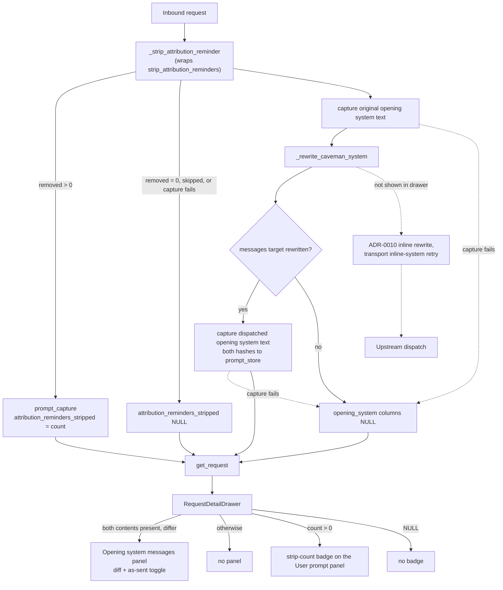

**Status**: Accepted

# Show inline system rewrites and attribution strip counts in the drawer

Amends ADR-0024 Decision 1 and the Decision 3 consequence about earlier user turns.

## Context

ADR-0024 made the request drawer diff what the sanitizer, the attribution strip (ADR-0023) and the caveman rewrite (ADR-0022) changed. It left two things out:

- **Inline `role:'system'` messages.** Claude Code carries its output style and the caveman ruleset in the opening turn's inline `role:'system'` message, not in `system`. ADR-0022 Decision 8 rewrites it as a second target. On the recorded traffic of the running proxy (2026-11-02 and 2026-11-03), the log shows 223 `target=messages dispatched=rewritten` lines against 58 `target=system dispatched=rewritten` lines. The drawer shows none of the 223.
- **Attribution strips on earlier turns.** `strip_attribution_reminders` strips every user turn on every request, but the drawer diffs only the last user message (ADR-0024 Decision 3). The same traffic logged 688 strip lines (one INFO line per request that had a reminder stripped, ADR-0023 Decision 7) and has 23 rows with a user-text diff. A reminder in an earlier turn is stripped again, and logged again, on every later request, so 688 overstates the number of distinct reminders. The gap is still real: a strip on turn 3 leaves no trace when an operator opens turn 10.

ADR-0004's reasoning still holds: the drawer's trust boundary is the admin UI's, and the content is already in the operator's own database.

## Decision

1. **Opening system messages panel.** A third prompt panel, "Opening system messages", renders the diff from the original opening `role:'system'` text to the dispatched text. It reuses `PromptPanel` from ADR-0024: badge, line diff then word diff, "as sent" toggle, the same size fallback, copy copies the original. It appears only when the caveman rewrite changed the messages target. An unchanged request has no panel, because nothing is stored for it. "As sent" here means the text after the caveman stage, as it is for the other panels in ADR-0024. Two later steps can still change the bytes upstream receives: the model-gated inline rewrite of ADR-0010 and the transport's inline-system retry (ADR-0022 Decision 2). The drawer does not show those.
2. **Representation.** The text of each opening `role:'system'` block, in order, joined by a blank line. `opening_system_blocks` already collects those blocks for the rewriter, so the capture adds no new parsing. The original is taken before the rewrite and the dispatched text after `write_opening_system_blocks`.
3. **Storage.** Two new nullable columns, `requests.opening_system_sha256` (original) and `requests.opening_system_dispatched_sha256` (rewritten), with the content in `prompt_store` as `content_type='system'`, which the existing CHECK allows. The text repeats within a session and the rewriter's cache makes the rewrite byte-stable, so hash dedup makes repeats free. Both columns are written together, only when the rewrite changed the messages target. NULL means unchanged, or the request never reached the stage. A failure to capture logs a warning and leaves both NULL (recording never affects handling).
4. **Read side.** `get_request` LEFT JOINs both hashes and returns `opening_system_content` and `opening_system_dispatched_content`. The server owns what counts as changed, as in ADR-0024 Decision 4. A non-NULL hash with no `prompt_store` row yields NULL content, and the drawer then shows no panel, the same degraded behavior ADR-0004 set; the operator cannot tell it from unchanged.
5. **Strip count.** New nullable integer `requests.attribution_reminders_stripped`, written only when `strip_attribution_reminders` removed at least one reminder, with that count. `_strip_attribution_reminder` today only logs the count from `strip_attribution_reminders`; it now also stores it in `prompt_capture`. NULL means none stripped, or no data: rows before this ships, requests that never reached the stage, and security-monitor requests, where the stage is skipped (ADR-0023 Decision 5). A failure to capture logs a warning and leaves the column NULL, which is then indistinguishable from "none stripped". That false negative is accepted: capture is a count read from a value the stage already computes, so a failure is unlikely, and recording must never affect request handling. The drawer shows "N attribution reminders stripped" as a badge on the User prompt header, next to the "changed by proxy" badge when both apply, and the count covers every user turn. The badge shows even when the last user message is unchanged, which is the case it exists for. The last-message text diff of ADR-0024 Decision 3 is unchanged, and no diff is stored for earlier turns.
6. **Schema.** Migration 7 (v7 → v8; v6 → v7 was migration 6, the upstream `request-id` column of ADR-0026): three `ALTER TABLE ... ADD COLUMN`, each behind a column-exists guard like `_apply_migration_3`, and the two `prompt_store` ref-count triggers recreated to count the two new hash columns, as migration 4 did for the caveman column. Without that, the retention prune would delete content a live row still references. `ensure_schema` runs each migration and its `user_version` bump in one `with conn:` block, but sqlite3 autocommits DDL outside that transaction (see `_apply_migration_3`), so an interrupted start can leave the columns added at v7. The next start re-runs migration 7: the column guards skip the ALTERs, and `DROP TRIGGER IF EXISTS` plus `CREATE TRIGGER` recreates both triggers, so a partial run heals itself. A trigger that cannot be recreated raises and aborts startup, as for migration 4.
7. **Search.** FTS keeps indexing `user_prompt_text` only.
8. **Out of scope.**
   - Inline `role:'system'` rewrites made by ADR-0010 for Sonnet 4.6 and Haiku 4.5 (a model-gated rewrite after routing, not a content stage).
   - The ADR-0013 body-field edits (`fallbacks`, `max_tokens`, `effort`, `thinking`). They are rare, deterministic and covered by tests. Revisit if an operator hits a 400 they cannot explain from the drawer.

## Consequences

- Rows recorded before this ships have NULL in all three columns: no panel, no badge. There is no backfill, since the original opening text was never stored.
- A messages-target rewrite adds two `prompt_store` rows per distinct opening system text. The text changes per session, so expect one pair per session.
- The caveman `system` target and the messages target now both show in the drawer, as separate panels, because they have different originals and different dispatched texts.
- Amends ADR-0024 Decision 1, which put inline `role:'system'` messages out of scope: the caveman messages target is now in scope. The ADR-0010 rewrite stays out. Amends ADR-0024 Decision 3's consequence "A strip in an earlier user turn gets no badge": it now gets a count badge, still no diff.
- Verified against the live database before this decision: the existing system and user-text diffs are correct on real rows (58 caveman system rows and 23 attribution rows, 9,188 sanitizer rows), so this ADR adds coverage and leaves those diffs unchanged. It does add a badge next to an existing one, and it recreates the ref-count triggers (Decision 6).

## Considered Options

- **Store the full original `messages` body.** Rejected: large and per-turn, and it would serve one consumer.
- **Per-turn diffs for attribution strips.** Rejected: needs a per-message record on every request for a stage whose span is always the same fixed reminder. A count says it happened.
- **Leave the messages target out and document it.** Rejected: it hides most caveman edits on the traffic that exists, which is the opposite of what ADR-0024 set out to show.
