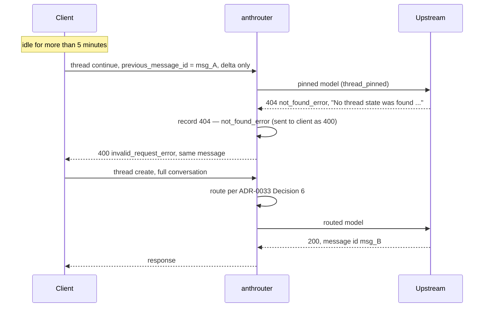

**Status**: Accepted

# Send an expired-Thread 404 to the client as a 400, so the client replays the conversation

Amends ADR-0028 Decision 1 for one upstream message. Closes the open question in ADR-0027 Consequences about the cause of the Thread 404.

## Context

A Thread expires 5 minutes after its last request (ADR-0027 Context). A continuation of an expired Thread gets:

```
HTTP 404 not_found_error: No thread state was found for the requested `previous_message_id`. Replay the full conversation with `thread: {"type": "create"}` to start a new Thread.
```

Upstream sends no `error.code` for this 404. Only the message text identifies it.

Evidence from 2026-11-02 and 2026-11-03 (`docs/research/2026-11-03-request-18534-404-not-found.md`):

- **The expiry is consistent.** 353 `thread_pinned` continuations succeeded. The longest idle gap before a success was 235 s. Every continuation after an idle gap of more than 5 minutes (5 of 5) got the 404. The pinned model was always the Thread's own model.
- **The client does not replay after a 404.** Claude Desktop (`cc_version=2.1.309`) sends the request once streaming and once non-streaming, and then stops. It shows "Model isn't available". In all 5 incidents, the user typed `Try again`. Only then did the client replay the full conversation with `{"type": "create"}`, and that replay succeeded.
- **The client replays after a Thread 400.** After the 2026-11-02 model-mismatch 400 (`differing field(s): model`), the client sent a working request on average 3.1 s later (124 cases), with no user action.
- **How the client receives each error.** In every cycle the client sends the request streaming first. anthrouter has already sent HTTP 200, so the error arrives as an SSE `error` event. The client then resends it non-streaming and gets the HTTP status. After the Thread 400, the replay followed the non-streaming HTTP 400. So the observed trigger is an HTTP 400. Whether an SSE `invalid_request_error` alone also triggers it is not known.
- **Counts.** The 5 incidents above are the rows recorded as `404 — not_found_error` on 2026-11-03 (10 rows: each incident is one streaming and one non-streaming request). The 37 rows that ADR-0028 counts are the same 404 on 2026-11-02, recorded as `502 — api_error` and including the client's retries. Those clusters also followed gaps of 7–20 minutes.
- **The old 502 did not help either.** Before ADR-0028, the same 404 reached the client as a 502. The client retried the same dead continuation up to 12 times and did not replay.

The idle gap comes from the client: the user takes time to approve a tool call or to come back. anthrouter does not cause the expiry. But anthrouter is the only place that can change how the client sees the error, and the client already has a recovery path that a 400 triggers.

## Decision

1. **Rewrite.** In `handle_error_response()` (`anthrouter/http_util.py`), when the upstream status is `404` and the upstream message starts with `No thread state was found`, raise `AnthropicRequestError(status_code=400, error_type='invalid_request_error')` with upstream's message unchanged. The match is narrow on purpose. Every other 404 stays a 404 (ADR-0028). If upstream changes the wording, the rewrite stops and the behaviour falls back to the plain 404 of ADR-0028. Both the status and the message prefix must match, so the rule does not fire for any other error seen so far. The rewrite applies to every client, not only Claude Desktop. The replay behaviour is verified for Claude Desktop only. A client with no replay logic gets a 400 in place of a 404, and it fails in the same way it fails today.
2. **Both paths.** The non-streaming path sends HTTP 400. The streaming path has already sent HTTP 200, so it sends an SSE `error` event whose `error.type` is `invalid_request_error`. Both paths raise from `handle_error_response()`, so one rewrite covers both.

   *Amended by ADR-0032:* a streaming request with a `thread` field holds the 200 until the first upstream chunk or the first keepalive. An expired Thread on such a request gets HTTP 400, not an SSE `error` event.
3. **The database records the upstream truth.** The exception carries the upstream status (`upstream_status=404`) and the upstream `error.type` (`not_found_error`). The `error` column keeps the upstream status, as ADR-0028 Decision 3 requires, and marks the rewrite: `404 — not_found_error (sent to client as 400)`. A 404 that did not match the rule stays `404 — not_found_error`. Both record paths (`do_POST` and `_usage_sse_wrapper`) change to build this value from `upstream_status` and the upstream type, not from `exc.status_code`. So queries can separate an expired Thread from a model-mismatch `400`, and a rewritten 404 from one that was passed through.
4. **Log.** The `Upstream error HTTP 404` warning is unchanged. One more INFO line, `Upstream Thread not found (usually expired): sent to client as 400 so it replays`, records that the rewrite fired.
5. **Admin UI drawer hint.** In the request drawer, a row whose `error` is `404 — not_found_error (sent to client as 400)` shows: "Upstream Thread not found, most likely expired (no request for more than 5 minutes). anthrouter sent it to the client as a 400 so the client replays the conversation. This is not a model fault." No new `ReasonCode` is added. `reason_code` describes the routing decision, which is made before dispatch, when the expiry is not yet known.
6. **Automated tests.** Unit tests for `handle_error_response()` cover every row of the API Contract table: the matching 404 becomes a 400, any other 404 stays a 404, and other statuses are unchanged. They also check that the rewritten 400 is not retried, that the streaming path sends an SSE `invalid_request_error`, and that the DB value carries the marker.
7. **Acceptance test.** The decision depends on an observed client behaviour, not a documented one. After the change ships, leave a Claude Desktop session idle for more than 5 minutes, then send a message. The test passes when, with no user action, the 404 row is followed within seconds by a successful row from the same session with a large `total_messages` and a `thread=create` log line. Record whether the replay followed the streaming SSE error or the non-streaming HTTP 400. If the client does not replay, revert the rewrite, so the behaviour goes back to the plain 404 of ADR-0028. A rewrite that does not help only hides the upstream status. Then move this ADR to **Rejected**, remove the proposal notes from ADR-0027 and ADR-0028 (keep the closed cause question in ADR-0027: the expiry evidence stays valid), and decide the fallback below in a new ADR.

## Acceptance Result

**Passed** on 2026-11-03 in two incidents in one Claude Desktop session (`9e9ee298`). Research: `docs/research/2026-11-03-requests-20007-20009-two-thread-errors.md`.

| Incident | Thread idle gap | Streaming attempt | Non-streaming attempt | Replay (`thread=create`) |
| -------- | --------------- | ----------------- | --------------------- | ------------------------ |
| #20007–#20009 | ~470 s | #20007, SSE `invalid_request_error` | #20008, HTTP 400 | #20009, 47 ms after the 400, success |
| #20137–#20139 | ~320 s | #20137, SSE `invalid_request_error` | #20138, HTTP 400 | #20139, 41 ms after the 400, success |

- The replay followed the non-streaming HTTP 400. It did not follow the SSE error: after the SSE error the client resent the same continuation non-streaming. So an SSE `invalid_request_error` alone does not trigger the replay for this client.
- No user action was needed. Each incident still costs one extra failed request: the streaming attempt.

## API Contract

| Upstream response | Client status (non-streaming) | Client SSE `error.type` (streaming) | Client message | DB `error` |
| ----------------- | ----------------------------- | ----------------------------------- | -------------- | ---------- |
| 404, message starts with `No thread state was found` | 400 | `invalid_request_error` | upstream's, unchanged | `404 — not_found_error (sent to client as 400)` |
| any other 404 | 404 | upstream type (`not_found_error`) | upstream's, unchanged | `404 — <type>` |
| every other status | as ADR-0028 | as ADR-0028 | as ADR-0028 | as ADR-0028 |

*Amended by ADR-0032:* the streaming column applies only when the 200 is already committed. A streaming request with a `thread` field whose error comes before the 200 is committed gets the non-streaming status and JSON body.

anthrouter does not retry the rewritten 400. `RETRYABLE_STATUSES` is checked against the upstream status (404), which is not in it.

## Use Case Sequence

The sequence shows the non-streaming path. Before ADR-0032, the client first sent the same continuation streaming and got HTTP 200 plus an SSE `invalid_request_error`. Then it sent the non-streaming request shown here (Acceptance Result).



*Amended by ADR-0033:* the replay is not routed with the tier cache. It is a `thread=create` with prior assistant messages, so it is classified under ADR-0033 Decision 6.

## Considered Options

- **anthrouter replays the Thread itself.** anthrouter would store each Thread's full conversation: the create request's messages, every assistant reply rebuilt from the response stream (including thinking signatures and `tool_use` blocks), and every delta. On a 404 it would send `{"type": "create"}` with all of it. This is the fallback if the acceptance test fails. It was not chosen first because it holds full conversations in memory, a rebuilt reply that differs from upstream's can break the replay, and it adds a new data-retention surface.
- **Stop Threads at the proxy** (strip `thread` and the beta header). Rejected. A continuation carries only the delta, so upstream would answer it with no history unless the client falls back, and that client behaviour is unknown.
- **A proxy-side expiry warning** (store the last-use time of each pinned id, and warn after 5 minutes). Rejected. It says ahead of time what the 404 already says, and it needs a TTL that ADR-0027 Decision 3 rules out.
- **A new `ReasonCode` such as `thread_expired`.** Rejected. A reason code is set before dispatch, and the expiry is known only after the response.
- **Match only this one message, when ADR-0028 rejected that.** ADR-0028 rejected a one-message rule as a way to *pass statuses through*, because the same fault applied to every 4xx. Here the rule does something different: it adapts one message to one client recovery path that exists. No other 4xx has a known recovery that a different status would unlock. The general pass-through stays in force for all of them.
- **Keep the 404 and report the missing replay to the client team only.** Rejected as the only action. The user has to type `Try again` until the client changes, and the proxy can fix it now.

## Consequences

- The client recovers from an expired Thread with no user action. The cost today is two failed requests (the streaming SSE error, then the non-streaming 400) plus a full replay, and the replay is routed again as a new Thread. ADR-0032 aims to reduce this to one failed request.

  *Amended by ADR-0033:* the replay is classified under ADR-0033 Decision 6, not routed with the tier cache.
- anthrouter sends a status that differs from upstream's for one message. This goes against ADR-0028's rule to pass every 4xx through. The exception is narrow, and the DB and the log keep the upstream status.
- The rewrite depends on upstream's message text and on the client's undocumented reaction to a Thread 400. If either one changes, the behaviour falls back to the plain 404 or to the manual `Try again` of today. Neither of these sends the client into a retry loop.
- ADR-0027 open question: every Thread 404 seen so far followed an idle gap of more than 5 minutes and a pin to the Thread's own model. So the 404 comes from expiry, not from an earlier model mismatch.
