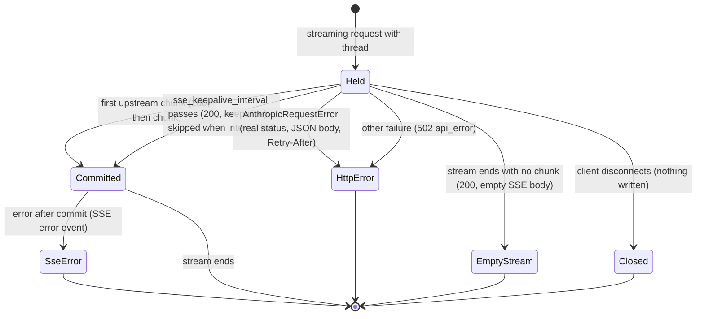
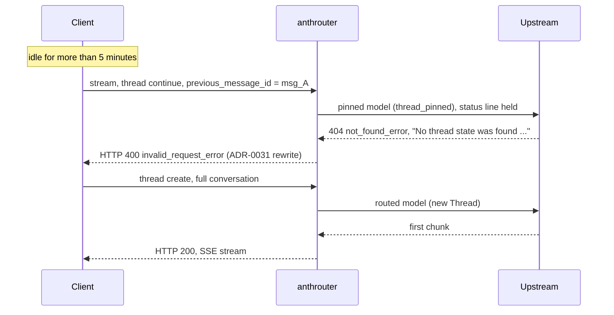

**Status**: Accepted

# Hold the streaming 200 for Thread requests until the first upstream chunk or the first keepalive

Amends ADR-0031 Decision 2 and ADR-0026 (a streaming request commits HTTP 200 before the upstream is called) for streaming requests that carry a `thread` field.

## Context

`_send_sse` sends HTTP 200 and the SSE headers before it primes the upstream stream (`anthrouter/handlers.py`). An upstream error that comes back before the first chunk can then reach the client only as an SSE `error` event.

ADR-0031 rewrites the expired-Thread 404 to a 400 so that Claude Desktop replays the conversation. The acceptance test passed twice (ADR-0031 Acceptance Result, #20007–#20009 and #20137–#20139). In both incidents the client ignored the SSE `invalid_request_error` on the streaming attempt. It sent the same dead continuation again, non-streaming, and replayed only after that request's HTTP 400. So every expired Thread costs two failed requests before the replay. This change aims for one. It is kept only if it gets there (Decision 7).

Log data from 2026-11-02 to 2026-11-03 (`docs/research/2026-11-03-requests-20007-20009-two-thread-errors.md`):

- The upstream sent the expired-Thread 404 within 0.87 s at most (46 cases, median 0.37 s).
- Of 1 589 streaming `thread=continue` requests, 59 (3.7%) took 10 s or more to send the first chunk. The longest took 30.1 s. Of 156 streaming `thread=create` requests, 1 took 10 s or more (17.6 s).
- The first keepalive comment goes out only after `sse_keepalive_interval` (default 10 s). Before that, the early 200 puts nothing on the wire except the status line and the headers.
- No 429 or 529 before the first chunk on a Thread stream has been seen so far.

Side note, not a reason to keep the change: on a Thread stream, an error before the first chunk also gets its real HTTP status. A 429 before the first chunk also gets its `Retry-After` header, if anthrouter's own retries finish before the interval (Decision 3). No such 429 has been seen, so this effect is not measured. Decision 7 does not use it.

ADR-0026 says that a streaming 429 still reaches the client as HTTP 200 plus an in-band error frame (its out-of-scope note). For a Thread stream whose 429 comes before the 200 is committed, that note no longer holds. ADR-0026 is not edited.

## Decision

1. **Scope.** A streaming request whose body has a `thread` field (`create` or `continue`) holds the status line. A streaming request without `thread` keeps the commit-first behaviour of ADR-0026: 200 first, then priming. For Thread streams, the expired-Thread 400 is the benefit this change targets. The Thread-wide scope is chosen for a simple rule: "the request has `thread`". Holding only `thread=continue` would be a smaller change, because a `thread=create` cannot get the expired-Thread 404. That option is rejected: the hold costs a create only a later status line (Consequences), and the single rule is easier to test. If Decision 8 triggers on a create alone, the revert covers all Thread streams. This is accepted.
2. **When the 200 goes out.** The held request primes the upstream stream first. The first of these events ends the hold:
   - The first upstream chunk arrives. The 200 goes out, then that chunk.
   - `sse_keepalive_interval` passes with no chunk. The 200 goes out with the first keepalive comment, and keepalives continue as they do today.
   - The upstream stream ends with no chunk and no error. The 200 goes out with an empty SSE body, the same as today.
   - An error is raised. Decision 3 applies.
   - The client disconnects. Decision 5 applies.

   When keepalive is off (`sse_keepalive_interval = 0`), there is no keepalive event. The upstream socket timeout (`DEFAULT_TIMEOUT = 300` s in `anthrouter/http_util.py`) limits the hold. This timeout applies to each socket read, not to the whole request. An upstream that sends a few bytes before each 300 s timeout ends can hold the status line for longer than 300 s. A timeout error raised before the 200 is committed goes to the client as a real status under Decision 3.
3. **Errors before the 200.**
   - Every `AnthropicRequestError` raised before the 200 is committed goes to the client as a real HTTP error response, the same response the non-streaming path sends: the same status, the same JSON error body, and `Retry-After` where the non-streaming path sends one. Examples: the expired-Thread 400 of ADR-0031, a 429, a 529.
   - Any other failure raised before the 200 is committed goes to the client as HTTP 502 with a JSON `api_error` body, the same shape as the non-streaming path.
   - anthrouter's own retries (statuses in `RETRYABLE_STATUSES`, `anthrouter/http_util.py`) run inside the hold, and their time counts against `sse_keepalive_interval`. If a 429 is still being retried when the interval passes, the 200 is committed with the first keepalive, and the 429 goes in-band as today.
   - An error raised after the 200 is committed keeps the current in-band SSE `error` event.
4. **Recording.** The `requests` row is unchanged: the `status` and `error` columns follow ADR-0026 Decision 3 and ADR-0031 Decision 3. A held 429 is recorded as `rate_limited`, as before. The access log line (`"POST /v1/messages ..." <status>`) now shows the real status for an error sent before the 200.
5. **Client disconnect during the hold.** If the client closes the connection before the 200 is committed, the request is handled like a disconnect during the keepalive wait today: the priming thread is never abandoned, and nothing more is written.
6. **Automated tests.** One test for each branch of the State Diagram:
   - The first chunk arrives before the interval: 200, then the chunk.
   - The interval passes first: 200 with the first keepalive comment, then the stream.
   - Keepalive is off: the request holds until the first chunk, and no keepalive is written.
   - An `AnthropicRequestError` before the commit: the client gets the real status, the non-streaming JSON error body, and `Retry-After` when the upstream sent one.
   - Any other failure before the commit: HTTP 502 with a JSON `api_error` body.
   - The upstream stream ends with zero chunks: 200 with an empty SSE body.
   - An error after the commit: an SSE `error` event.
   - A client disconnect during the hold: nothing is written, and the priming thread is not abandoned.
   - A streaming request without `thread`: 200 before priming, unchanged.
7. **Acceptance test.** After this ships, leave a Claude Desktop session idle for more than 5 minutes, then send a message. Record the result in this ADR.
   - **Pass:** the streaming attempt gets HTTP 400, and the `thread=create` replay follows it with no non-streaming retry in between. The incident has one error row, not two.
   - **Fail:** any other result. This includes the case where the client still sends the non-streaming retry after the streaming 400 and then replays, because the change then gives no gain. It also includes the case where the client does not replay after the streaming 400. On a fail, revert this change, so the streaming path goes back to ADR-0031 Decision 2 behaviour (200, then an SSE `error` event). Record the observed client behaviour here, and move this ADR to **Rejected**. The unmeasured effect on a 429 (Context) is not a reason to keep the change.
8. **Early-headers failure rule.** The change assumes that no client or intermediary needs the status line before the first chunk or the first keepalive (Consequences). If a client or an intermediary times out while it waits for the headers of a Thread stream, revert this change to commit-first, record the incident here, and move this ADR to **Rejected**.

## API Contract

Streaming request (`"stream": true`) with a `thread` field:

| Event | Client status line | Client body |
| ----- | ------------------ | ----------- |
| First upstream chunk before `sse_keepalive_interval` | 200 | SSE stream, unchanged |
| `sse_keepalive_interval` passes first | 200 | `: keepalive` comments, then the SSE stream |
| Upstream stream ends with no chunk and no error, before the interval | 200 | empty SSE body, the same as today |
| `AnthropicRequestError` before the 200 is committed | upstream status, after ADR-0028 and ADR-0031 (for example 400 for an expired Thread, 429 with `Retry-After`) | JSON error body, the same as the non-streaming path |
| Any other failure before the 200 is committed | 502 | JSON `api_error` body, the same as the non-streaming path |
| Upstream error after the 200 is committed (including a 429 still in retry when the interval passes) | 200 (already sent) | SSE `error` event, unchanged |
| Client disconnects before the 200 is committed | none | none |

A streaming request without `thread`, and every non-streaming request: unchanged.

## State Diagram

## Use Case Sequence

## Considered Options

- **Keep the current behaviour (docs only).** Rejected. Recovery works, but every expired Thread costs two failed requests before the replay. If Decision 7 fails, anthrouter goes back to this option.
- **Hold the 200 for every streaming request.** Rejected for now. For Thread streams, the expired-Thread 400 is the benefit this change targets. Requests without `thread` gain nothing from the hold, so they keep the commit-first behaviour of ADR-0026.
- **Hold only for `thread=continue`.** Rejected. Only a continuation can hit the expired-Thread 404, so this is a smaller change. But the hold costs a create only a later status line, and the single rule "the request has `thread`" is easier to test (Decision 1). If Decision 8 triggers on a create alone, the revert covers all Thread streams. This is accepted.
- **Commit the 200 when the upstream sends its own response status, not at the first chunk.** Rejected. Inside the transport, the upstream status is known before the first chunk: `_send_with_retries()` returns after `getresponse()` (`anthrouter/transport.py`). Every upstream error that comes before the first chunk also comes before the upstream 200, because after its 200 the upstream sends errors in-band. So both points catch the same errors. But `send_message_stream()` is a generator that gives the handler nothing until the first SSE event. To commit on the upstream status, the transport must expose a second step to the handler. The first-chunk point needs no transport change: `_prime_sse_with_keepalive()` already waits for the first chunk or the keepalive interval. How long the upstream holds its status line before the first chunk is not measured. If that gap proves large, this option can come back in a new ADR.
- **A separate short hold limit (for example 2 s).** Rejected. A fixed short limit commits the 200 before a slow error arrives, so that error goes in-band again. One example is a 429 that anthrouter retries for more than 2 s. A second limit also differs from the keepalive interval, which is already the point where the client must see bytes. The hold uses that point.
- **Rewrite only the expired-Thread error to a real status.** Rejected. One rule for every error before the 200 keeps the meaning of each status, and it gives a 429 its `Retry-After` when the retries finish inside the hold.

## Consequences

- An expired Thread on a streaming request reaches the client as HTTP 400. The change is kept only if this removes the extra failed request (Decision 7). Otherwise it is reverted.
- On a Thread stream, the status line and the headers are delayed by up to `sse_keepalive_interval`, and never later than the first chunk. This applies to `thread=create` too. The body bytes come no later than before, because the first keepalive was never sent before the interval. This assumes that the client and any intermediary do not depend on early headers. That assumption is not verified. Decision 8 reverts the change if it proves false.
- With keepalive off, the status line can be held up to the upstream socket timeout (`DEFAULT_TIMEOUT = 300` s). Because the timeout applies to each read, a slow upstream can hold it for longer.
- While the change is in place, a 429 or 529 before the first chunk on a Thread stream becomes a real status with `Retry-After`, if anthrouter's retries finish before the interval. For these requests, the out-of-scope note in ADR-0026 no longer holds. This is a side effect, not a reason to keep the change.
- `_send_sse` has two commit modes: commit first (no `thread`) and commit on first chunk, keepalive, or end of stream (`thread`).
