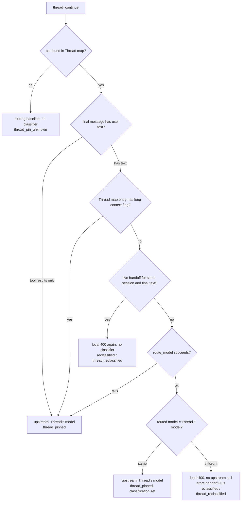
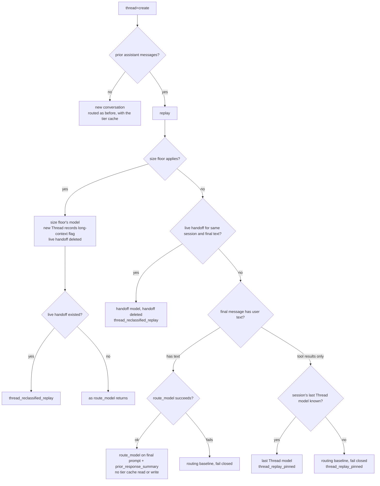
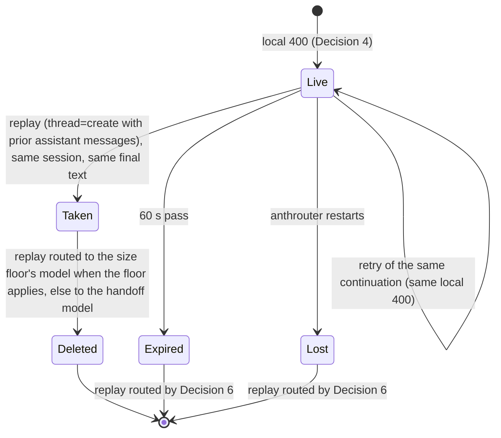
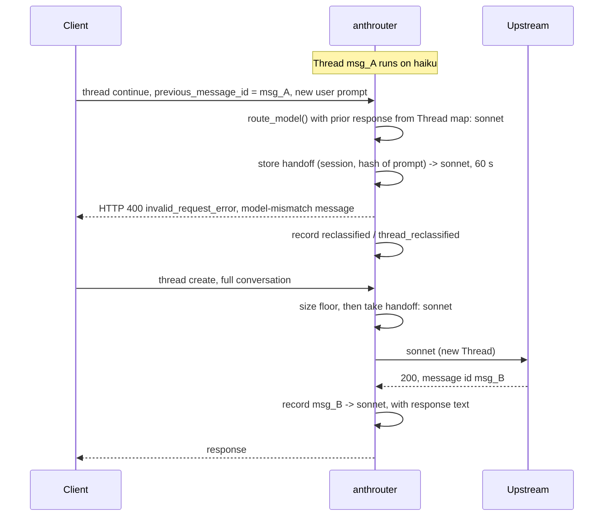

**Status**: Accepted

# Classify each new user prompt in a Thread, and ask the client for a new Thread when the model changes

Amends ADR-0027 Decision 4 (a pinned turn makes no classifier call) and its first Consequence (a Thread runs on one model for its whole life). Amends ADR-0031 Use Case Sequence (replay routing): a replay is routed by Decision 5 or Decision 6 of this ADR, not with the tier cache.

## Context

ADR-0027 pins every Thread continuation to the model that served its previous message. The tier chosen on the creating turn then holds for the life of the Thread. Before Threads arrived on 2026-11-02, anthrouter classified each user prompt and could move a conversation up or down a tier, with affirmation handling for short replies such as `yes`.

Request #20204 (session `978daf89`) shows the cost. The session opened with `hello`. The classifier rated it trivial, and the Thread was created on `haiku` (#20203; the model lock set the baseline to `sonnet`). Every later turn was pinned to `haiku`, including `/wayfinder`, `/retro` and the commits (#20204–#20220, context 47 k to 80 k tokens).

In this ADR, **tier cache** means the per-session routed-tier store (`SessionState.routed_tier()` and `set_routed_tier()`, `anthrouter/session_state.py`). Its key is `(context_key(), requested tier)`, and `context_key()` is the session key plus a hash of the first user message. AGENTS.md and ADR-0027 call the read of this store for a text-less turn the "walk-back cache". It is the same store. This ADR uses only the name "tier cache".

Facts that shape the decision:

- **Upstream fixes the model per Thread.** A continuation on another model gets `400 invalid_request_error`, `thread: … differing field(s): model` (ADR-0027 Context).
- **The client replays after that 400.** Before ADR-0027, Claude Desktop replayed the full conversation with `thread: {"type": "create"}` after this 400, on average 3.1 s later, with no user action (124 cases, ADR-0031 Context). The replay succeeded on any model. In those cases, the client first sent the request streaming and got an SSE `error` event. Then it sent the request non-streaming and got the HTTP 400. The replay followed the non-streaming HTTP 400. No case shows a replay after a streaming HTTP 400, because anthrouter did not send one then. Decision 11 tests exactly that.
- **A continuation carries no prior assistant text.** Continuations classified before the pin had `total_messages=2` and `prior_assistant_messages=0` (#17162–#17231). So the affirmation handling cannot find `prior_response_summary` in the payload.
- **The tier cache cannot help.** Its key comes from the first user message. A continuation's first user message is the new prompt. A replay's first user message is the conversation's opening turn: `hello` in #20203, which is cached as trivial.
- **Cost of a classifier call.** On average $0.002 and about 1 s (232 calls from 2026-11-03 04:29Z to 23:27Z). In the same window, 238 `thread_pinned` continuations carried a new user prompt.

## Decision

1. **Which continuations are classified.** anthrouter checks a Thread continuation in this order (Continuation Routing):
   1. **Pin not found** (`thread_pin_unknown`, ADR-0027). The Thread's model is not known, so no change can be detected. The continuation goes to the routing baseline (ADR-0027), with no classifier call and no handoff check.
   2. **Tool results only.** The final message carries only tool results (`route_model()` would return `missing_final_user_text`). The continuation stays pinned to the Thread's model, with no classifier call and no handoff check.
   3. **Long-context flag.** The Thread map entry has the long-context flag. The continuation stays pinned to the Thread's model, with no classifier call and no handoff check. The flag records that the Thread's recorded request carried a `context-1m*` beta (ADR-0027). It does not record the size of the conversation. So a client that always sends this beta keeps every Thread pinned. This is accepted: the beta marks Threads that need the 1M window. A model change on such a Thread would replay a large conversation with no prompt cache.
   4. **Live handoff.** Only a continuation that passed checks 1 to 3 is checked for a live handoff (Decision 5). If one exists, it gets the same local 400 again.
   5. **Classification.** Any other continuation goes through `route_model()`. It uses the normal layers: affirmation handling, the classifier, and the model lock cap (ADR-0016). It does not read or write the tier cache, because the cache key does not identify the conversation.

   A routing failure (classifier error, timeout, invalid output) fails closed to the Thread's model, and the turn is sent as a normal pinned continuation.

   **The size floor on a classified continuation.** `route_model()` runs the size floor first, as for any request. But the floor cannot see the Thread's real size. Its estimate (`estimate_input_tokens`) counts only the continuation payload, which carries the new delta and not the history. The measured session context size that the floor also uses is read by `context_key()`, and the key of a continuation hashes its first user message, which is the new prompt. So no measured size is found for it. The floor fires on a continuation only when the delta alone meets the threshold. The long-context flag (check 3) covers Threads that need the 1M window.
2. **Prior response.** Each Thread map entry (ADR-0027 Decision 3) also stores the response text of the message it records. The text is truncated to `auto_model_routing_prior_response_summary_limit` (default 1 000 characters). On the next continuation, this text is the `prior_response_summary` that the classifier and the affirmation handling see. `RoutingSummary.to_classifier_json()` already carries this field. No new field reaches the classifier.
3. **Same model.** When the routed model equals the Thread's model, the turn is sent upstream as a pinned continuation. The row keeps `reason_code='thread_pinned'` and also records the `classification`.
4. **Different model: a local 400.** When the routed model differs from the Thread's model, in either direction, anthrouter does not call upstream. It answers with HTTP 400 `invalid_request_error` and upstream's own model-mismatch message:

   ```
   thread: the request does not match the stored Thread for the requested `previous_message_id`; differing field(s): model. These fields must stay the same across a Thread's turns; to change them, start a new Thread with `thread: {"type": "create"}` and replay the conversation.
   ```

   This is upstream's text as logged on 2026-11-02, unchanged.

   The decision is made before any response byte is sent, so a streaming request also gets a real HTTP 400, not an SSE error. This does not depend on ADR-0032.

   This applies to every client, with one rule and no client detection. A client that cannot replay after a Thread 400 is not compatible with anthrouter's Thread handling, so it is not a supported client. Such a client gets this 400 on every user prompt that routes to another model, and that turn fails. The clients seen so far replay (Context).
5. **Handoff to the replay.** At the same time, anthrouter stores a one-time handoff: key = session key plus the SHA-256 of the final user text, value = the routed model and its routing decision. The handoff expires after 60 s.
   - **The key.** The hash is taken on the final user text as the client sent it. On both the continuation and the replay, it is taken before the sanitizer, the attribution-reminder strip and the caveman rewrite. The key does not contain `previous_message_id`.
   - **Assumption.** The match needs the client to replay the same final user text, byte for byte. If the client changes that text in the replay, the replay takes no handoff and is routed by Decision 6. Decision 11 tests this assumption.
   - **Why a TTL is acceptable here.** ADR-0031 rejected an option based on a TTL. That option needed a TTL equal to upstream's 5-minute Thread expiry, kept in step with it, and ADR-0027 Decision 3 rules out a TTL on the Thread map. The handoff TTL is different. It is a short local bound with no link to upstream expiry. A wrong value only costs one thing: the replay is routed normally under Decision 6.
   - **Who can take it.** Only a replay can take the handoff: a `thread=create` that carries one or more prior assistant messages. A `thread=create` with no prior assistant message never takes it.
   - **The replay.** The next replay in the same session that has the same final user text takes the handoff. It skips the tier cache, affirmation handling and the classifier. The long-context size floor runs first. When the size floor applies (the conversation needs the 1M window), the size floor wins: the replay goes to the size floor's model, not the handoff model. The new Thread then records the long-context flag, so its later continuations stay pinned (Decision 1). This ends the cycle. The row keeps `reason_code='thread_reclassified_replay'`, and `routed_model` is the size floor's model. In every case, the handoff is then deleted.
   - **A retry of the same continuation.** If the client resends the same continuation (for example, non-streaming after streaming) while the handoff is live, anthrouter sends the same local 400 with no new classifier call. The key does not contain `previous_message_id`. So, within the 60 s, any continuation in the same session with the same final user text also gets this 400. This is accepted: a user rarely sends the same text twice within 60 s.
   - The handoff is in memory only, like the Thread map. After a restart, or after it expires, no handoff exists, and the replay is routed by Decision 6.
   - **A replay that took the handoff and then fails upstream** (for example, a 429). The handoff is already deleted. The client's retry of the same `thread=create` is routed by Decision 6: it is classified, with no tier cache. Its model can differ from the handoff model. This is accepted: the retry creates a new Thread, so no model-mismatch 400 can follow.
6. **Replay without a handoff.** A `thread=create` request that carries one or more prior assistant messages is a replay of an existing conversation, not a new one. When it takes no handoff, it neither reads nor writes the tier cache. The size floor runs first. Then the final message decides the route (Create Routing):
   - **The final message has user text.** The replay goes through `route_model()` and is classified on its final user prompt plus the `prior_response_summary` taken from its last prior assistant message. Affirmation handling and the model lock cap still apply. A routing failure (classifier error, timeout, invalid output) fails closed to the routing baseline (ADR-0016).
   - **The final message has only tool results.** The replay is not classified. It stays on the model of the Thread it replaces. A `thread=create` request does not carry `previous_message_id`, so anthrouter cannot look up that Thread's map entry. Instead, it uses the session's last Thread model: `SessionState` stores, per session key, the model of the last Thread map entry recorded in that session. `record_thread()` writes this value each time it records a Thread map entry. The store is bounded like the other `SessionState` stores. If no last Thread model is known for the session (for example, after a restart), the replay goes to the routing baseline. This fails closed (ADR-0016). The row gets `reason_code='thread_replay_pinned'`. If one session runs more than one conversation, the last Thread model can come from another conversation. This is accepted: it is the only Thread model known, and the model lock cap still applies.

   This covers:
   - the expired-Thread replay of ADR-0031 and ADR-0032,
   - a replay after an anthrouter restart,
   - a replay after the handoff expired.

   A `thread=create` with no prior assistant message is a new conversation, and it is routed as before, with the tier cache.

   A continuation that routes to the Thread's own model (Decision 3) stores no handoff. If that Thread later expires, its replay is classified again under this Decision. This is accepted: it costs one more classifier call, about $0.002.
7. **Recording.** A local 400 from Decision 4 is recorded with:
   - `status='reclassified'`, a new value. Schema migration v8 to v9 rebuilds `requests` to add it to the `status` CHECK.
   - `reason_code='thread_reclassified'`, a new `ReasonCode`.
   - `routed_model` = the new model, `classification` = the new tier, `error` = NULL, cost = 0.

   A local 400 sent from a live handoff to a retry of the same continuation (Decision 5) is recorded the same way: `status='reclassified'`, `reason_code='thread_reclassified'`.

   The replay row from Decision 5 gets `reason_code='thread_reclassified_replay'`, a new `ReasonCode`. A tool-result-only replay with no handoff (Decision 6) gets `reason_code='thread_replay_pinned'`, a new `ReasonCode`. Error counts and dashboards do not count `reclassified` rows as errors.
8. **Admin UI.** The request list shows a `reclassification` badge, not `error`, for a `reclassified` row. The drawer says: "The new user prompt routes to <new model>, but this Thread runs on <Thread model>. anthrouter asked the client to start a new Thread on <new model>. No upstream call was made." The two new replay reason codes get their own list label and drawer text:

   | `reason_code` | List label | Drawer text |
   | ------------- | ---------- | ----------- |
   | `thread_replay_pinned` | `replay pinned` | "Replay kept on the last Thread model: its final message had only tool results." |
   | `thread_reclassified_replay` | `reclassified replay` | "Replay after a re-classification: routed to the model chosen for the earlier prompt." |

   Run `make ui-build` and commit `dist/` (AGENTS.md).
9. **Log.** One INFO line: `Thread re-classified: <Thread model> -> <new model> (tier=<tier>); sent model-mismatch 400 so the client opens a new Thread`. The replay logs `Thread re-classification handoff: model=<new model>`.
10. **Automated tests.**
    - A tool-result-only continuation stays pinned, with no classifier call.
    - A continuation whose Thread map entry has the long-context flag stays pinned, with no classifier call, and keeps its `context-1m*` beta.
    - A user-prompt continuation that routes to the Thread's model is sent upstream pinned, with the classification recorded.
    - A user-prompt continuation that routes to another model gets a local 400 for both streaming and non-streaming requests. No upstream call is made, and the row is `reclassified` / `thread_reclassified`.
    - A routing failure fails closed to the Thread's model.
    - A continuation with an unknown pin goes to the routing baseline, and a tool-result-only or long-context continuation stays pinned, even when a live handoff exists for its final text.
    - The handoff: the replay takes it and skips the classifier; a retry of the same continuation reuses it and is recorded as `reclassified` / `thread_reclassified`; it expires after 60 s; a create with a different final text does not take it.
    - The size floor wins over a live handoff: the replay goes to the size floor's model with `reason_code='thread_reclassified_replay'`, the new Thread records the long-context flag, and the handoff is deleted.
    - A `thread=create` with no prior assistant message and the same final text does not take a live handoff.
    - A replay takes the handoff and then fails upstream (for example, a 429). The client's retry of the same `thread=create` is routed by Decision 6: it is classified, with no tier cache, and takes no handoff.
    - A `thread=create` with prior assistant messages, user text and no handoff whose routing fails goes to the routing baseline.
    - The handoff key is the same when the sanitizer, the attribution-reminder strip or the caveman rewrite changes the final user text.
    - A `thread=create` with prior assistant messages and no handoff is classified on its final prompt and prior response summary, and it neither reads nor writes the tier cache. A `thread=create` with no prior assistant message still uses the tier cache.
    - A tool-result-only `thread=create` with prior assistant messages and no handoff goes to the session's last Thread model, with no classifier call and `reason_code='thread_replay_pinned'`. With no last Thread model known, it goes to the routing baseline.
    - `record_thread()` updates the session's last Thread model.
    - The Thread map stores the truncated response text, and it reaches `prior_response_summary`.
    - Migration v9 keeps every existing row and accepts `reclassified`.
11. **Acceptance test.** After this ships, open a Claude Desktop session with `hello` (a Thread on the trivial tier). Then send a prompt that classifies standard or deep. Record the result in this ADR.
    - **Pass:** with no user action, the `reclassified` row is followed within seconds by a `thread=create` row on the new model with `reason_code='thread_reclassified_replay'`. This shows that the replay took the handoff. It also confirms the assumption of Decision 5: the client replays the same final user text, byte for byte.
    - **Fail:** any other result. This includes the case where no replay arrives. It also includes the case where a replay arrives but does not take the handoff (for example, it gets `thread_replay_pinned` or a reason code from `route_model()`).

    Also record whether the client replayed after the streaming 400 or only after a non-streaming retry, and how many model changes per conversation occur in normal use, so the cost estimate in Consequences can be measured.

    On a fail, revert all of this ADR's behaviour: no classifier call for a continuation (Decisions 1 to 3), no local 400 and no handoff (Decisions 4 and 5), and no replay rule (Decision 6). Every continuation is then pinned with no classifier call, as in ADR-0027. Migration v9 stays applied, because a downgrade would rebuild `requests` again. The `reclassified` status value then stays in the CHECK but is not used. Record the result here and move this ADR to **Rejected**.

## API Contract

Thread continuation with a found pin:

| Final user message | Routed model vs Thread's model | Upstream call | Client response | `status` / `reason_code` |
| ------------------ | ------------------------------ | ------------- | --------------- | ------------------------ |
| tool results only | not classified | yes, Thread's model | upstream's | as today / `thread_pinned` |
| any, Thread map entry has the long-context flag | not classified | yes, Thread's model | upstream's | as today / `thread_pinned` |
| has text, routing fails | Thread's model (fail closed) | yes | upstream's | as today / `thread_pinned` |
| has text | same | yes, Thread's model | upstream's | as today / `thread_pinned`, `classification` set |
| has text | different | no | HTTP 400 `invalid_request_error`, model-mismatch message (stream and non-stream) | `reclassified` / `thread_reclassified` |
| has text, same continuation again while the handoff is live | not classified again | no | the same HTTP 400 | `reclassified` / `thread_reclassified` |

`thread=create`:

| Prior assistant messages | Handoff | Final message | Routed model | `reason_code` |
| ------------------------ | ------- | ------------- | ------------ | ------------- |
| none | never taken | any | as before, with the tier cache | as before |
| yes, size floor applies | live (then deleted) | any | size floor's model | `thread_reclassified_replay` |
| yes | live (then deleted) | any | handoff model | `thread_reclassified_replay` |
| yes, size floor applies | none | any | size floor's model | as `route_model()` returns |
| yes | none | has text | classified on the final prompt and the prior response summary, no tier cache read or write | as `route_model()` returns |
| yes | none | has text, routing fails | routing baseline (fail closed, ADR-0016) | as `route_model()` returns |
| yes | none | tool results only | session's last Thread model, or the routing baseline when none is known | `thread_replay_pinned` |

## Continuation Routing



## Create Routing



## Handoff Lifecycle



## Use Case Sequence



## Considered Options

- **Keep the pin for the life of a Thread (ADR-0027 as written).** Rejected. One trivial opening turn decides the tier for a whole working session (#20204).
- **Upgrade only.** Rejected. Before Threads, routing moved both ways, and a downgrade saves money on every later turn of a long conversation.
- **Never create a Thread below the baseline.** Rejected. It loses the savings of every trivial Thread, and it does not help when a Thread created on a high tier moves to easy work.
- **Use the expired-Thread message (ADR-0031) as the trigger.** Rejected. The model-mismatch message is true here, and the client has replayed after its non-streaming HTTP 400 in 124 cases.
- **Let the replay route normally, with the tier cache and no handoff.** Rejected. The tier cache is keyed by the opening turn, so the replay could go back to the old tier (#20203's cached trivial) and loop.
- **Classify the replay's final prompt with no tier cache and no handoff.** Rejected. This is the rule of Decision 6, and it is used when no handoff exists. As the main path it has two problems. It makes a second classifier call for the same prompt. And the classifier output is not deterministic: the replay can classify back to the Thread's old tier. Then the replay creates a Thread on the old model, the next prompt classifies to the new model again, and the 400 and the replay can repeat. The handoff makes the replay use the decision that caused the 400.
- **Re-classify only for clients known to replay (header detection).** Rejected. Client detection is fragile, and it adds a second code path. A client that cannot replay after a Thread 400 is not supported, so it is out of scope (Decision 4).
- **Hysteresis, or a cap on model changes per conversation.** Rejected for now. There is not enough data to set a threshold. Decision 11 measures how often model changes occur. A new ADR can add a limit after that measurement.
- **Record the local 400 as `status='success'` or `'error'`, with no migration.** Rejected. It is neither. Its own status keeps error counts and success counts true.

## Consequences

- **Classifier cost.** One classifier call per user prompt inside a Thread: about $0.0019 and about 1 s each. From 2026-11-03 04:29Z to 23:27Z (19 hours), 238 `thread_pinned` continuations carried a new user prompt. 238 × $0.002 is about $0.48 in that window, or roughly $0.60 for 24 hours of constant use. A replay with no handoff (Decision 6) also makes one classifier call, unless its final message has only tool results.
- **Cost of a model change.** One or two local 400s with no upstream call (the streaming attempt, then the non-streaming retry that reuses the handoff), then the full replay. The replay has no prompt cache on the new model. For #20204 (about 47 k tokens), that is about $0.18 of cache write on `sonnet`, against about $0.005 of cache read on `haiku`. Later turns run at the new tier's price. Before Threads, a model change had the same cache cost.
- **Accepted risk: no limit on model changes.** anthrouter has no threshold and no hysteresis for model changes in a conversation. Each change costs one or two local 400s plus a full replay with a full cache write. How often changes occur is not known until it is measured. Decision 11 records it, and a new ADR decides any limit.
- **Latency.** A user prompt inside a Thread waits for the classifier (about 1 s). A model change also adds the client's replay round trip.
- **Thread map memory.** Each entry also holds up to 1 000 characters of response text. At 10 000 entries, that is about 10 MB more.
- **Dependency on client behaviour.** The decision depends on the client replaying after the model-mismatch 400. That behaviour is observed, not documented. The acceptance test (Decision 11) covers Claude Desktop only.
- **Clients with no replay logic are not supported.** The re-classification applies to every client, with one rule and no client detection (Decision 4). A client that cannot replay after a Thread 400 is not compatible with anthrouter's Thread handling, so it is not a supported client. Such a client fails on every user prompt that routes to another model, including a request that would succeed on the pinned model. The clients seen so far replay. ADR-0031 Decision 1 already depends on the same client behaviour.
- **Replays no longer use the tier cache.** A `thread=create` with prior assistant messages is classified on its last prompt (Decision 6). It can route to a different tier than the same conversation got before. The tier cache keeps serving new conversations and text-less turns outside Threads.
- **Long-context Threads stay pinned.** A Thread with the long-context flag keeps its model for its whole life, as in ADR-0027 (Decision 1).
- **`thread_pinned` is no longer free of classifier calls.** A `thread_pinned` row can now carry a `classification`. Only tool-result-only turns and long-context Threads are pinned without a classifier call.
