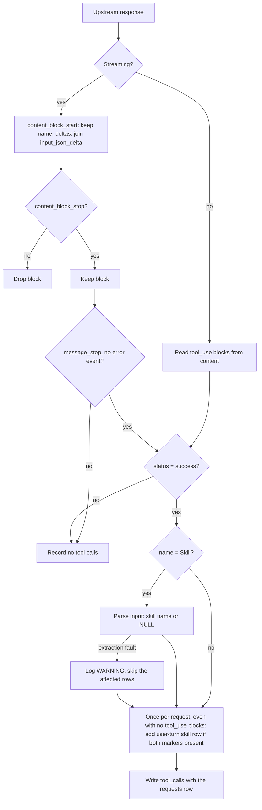

**Status**: Approved

# Record tool calls and skill usage in a `tool_calls` table

## Context

The `requests` table stores the final user text (`user_prompt_text`) and the final assistant text (`response_text`). It stores no tool calls. A turn in which the agent only calls tools has an empty `response_text`.

A question such as "which skills are used most" therefore needs a regex over `user_prompt_text`. That regex has two faults:

- It counts rows, not invocations. Skill text can reappear in later turns.
- It misses every skill the agent loads itself through the `Skill` tool, because those `tool_use` blocks are not stored.

Facts that shape the decision:

- A `tool_use` block appears in exactly one upstream response: the one that made the call. Every later request repeats it in its message history.
- In a streaming response the tool name arrives in `content_block_start`. The input arrives as `input_json_delta` fragments, so it is complete only at `content_block_stop`.
- Tool inputs can hold secrets (Bash commands, file contents).
- The classifier must never see tool names (AGENTS.md, Classifier-input privacy).
- Retention deletes `requests` rows after 30 days by default. A child table with `ON DELETE CASCADE` follows it, as `sanitizer_events` does.

## Decision

1. **Source: the upstream response.** Agent calls are read from the response, streaming and non-streaming. The streaming parser keeps the name from `content_block_start`, joins the `input_json_delta` fragments per block index, and reads the input at `content_block_stop`. A block that never reached `content_block_stop` is not recorded. A streaming response counts only if a parsed `message_stop` event arrived with no parsed `error` event; a stream cut before that records no tool calls of either source, even when the request row says `success`. A response that ends at the token limit (`stop_reason` `max_tokens`) is complete in this sense; a `tool_use` block cut mid-input never reaches `content_block_stop` and is dropped.
2. **A general table.** Schema v10 adds `tool_calls(id, request_id, tool_use_id, name, skill, source)`. `request_id` references `requests(id)` with `ON DELETE CASCADE`. One row per `tool_use` block, for every tool, not only `Skill`. `source` is `agent` or `user`.
3. **Only the skill name is stored from a tool input.** `skill` is filled when `name='Skill'` and is NULL otherwise. No other input is stored.
4. **Skill name form.** The name is stored as sent, minus one leading `/`. `/code-review` becomes `code-review`. `plugin:skill` stays as is. A `Skill` block whose input is not valid JSON, or has no `skill` string, still gets a row with `skill` NULL, so the call is counted as "a skill call, name unknown".
5. **User-typed skills.** A skill the user starts with a slash command is recorded with `source='user'` and `tool_use_id` NULL. It is detected in the final user turn of the request. The turn must hold both a `<command-name>` tag and a `Base directory for this skill:` text block. A client that resends the same user turn after a non-429 failure may be counted twice; this overcount is accepted. Built-in commands such as `/clear` carry the tag but not the text block, so they are excluded.
6. **Only successful requests.** Rows are written only when the request row has `status='success'`, for both sources. A stream that errors or is cut is not run by the client. A `reclassified` row (local 400, no upstream call) gets none, and the replay row counts the skill once. A request retried after a 429 gives one successful row.
7. **Record path only.** Capture runs where the response is recorded. Nothing is added to `RoutingSummary` or `to_classifier_json()`.
8. **Two failure kinds.** An extraction fault (bad JSON, unexpected block shape) never raises: it logs one WARNING and the request is recorded without the affected tool-call rows. A write fault is different: the `tool_calls` rows go in the same transaction as the `requests` row, so a failed insert loses both. That is the existing behaviour for any failed `requests` insert (`_record_db` logs and continues), and one transaction keeps the two tables from disagreeing.
9. **No backfill.** Old agent calls were never stored. A text-marker backfill would bring back the count-rows-not-invocations fault, and retention removes the old rows within weeks.
10. **No admin UI change.** The data is read with `sqlite3`. A UI panel needs `make ui-build` and a committed `dist/`, and can be a later ticket.

## Considered Options

- **Read `tool_use` blocks from the request history.** Rejected. Every later request repeats the block, so rows need dedupe by `tool_use.id` across requests. Compaction and sub-agents rewrite history, which makes the dedupe fragile.
- **A table for Skill calls only.** Rejected. It costs about the same code, and the general table also answers "which tools are used most". The extra volume is expected to be small: one row per tool call. No tool-call count exists today, since tool calls are not stored; measure after the first week.
- **Store full tool inputs.** Rejected. Inputs can hold secrets.
- **A JSON column on `requests`.** Rejected. Counting by skill would need `json_each` over every row, and retention cascade would not be visible in the schema.

## Capture path

## Consequences

- Schema version 9 becomes 10. The migration follows the existing pattern: a guarded `CREATE TABLE IF NOT EXISTS`, an index on `request_id` (cascade deletes), and an index on `(name, skill)` (usage counts).
- The `skill` of a `source='user'` row is the name inside the `<command-name>` tag, normalized as in Decision 4. These rows rest on two text markers in a client's prompt. A client that changes them stops being counted. The agent source does not depend on them.
- Decision 6 assumes a client does not run a tool whose stream errored or was cut. This is assumed for Claude Code and not tested per client.
- A skill loaded without a `Skill` tool call or a slash command is not recorded as a skill. Any `tool_use` it makes is still recorded under its tool name.
